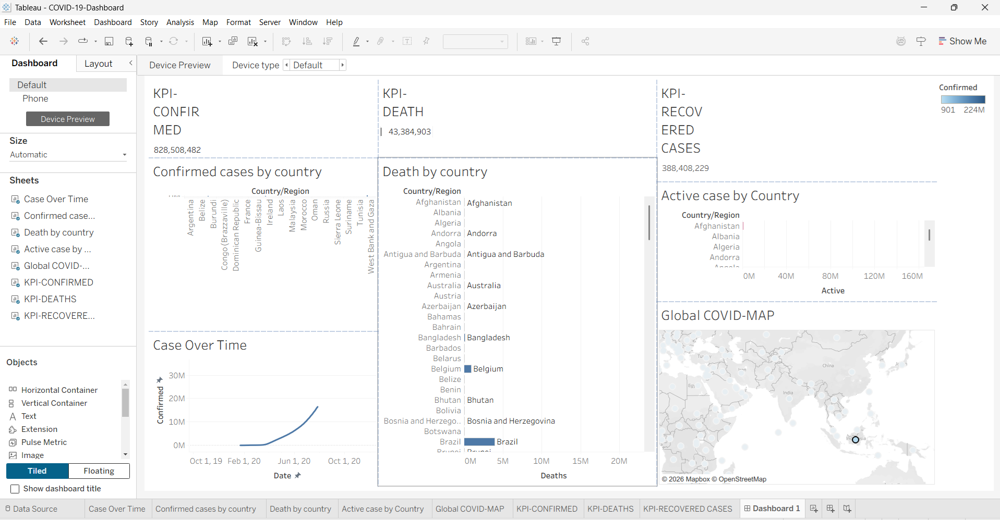

# COVID-19 Data Analysis Dashboard

## About Project
An interactive COVID-19 dashboard developed using Tableau.

## Tools Used
- Tableau Public
- CSV Dataset
- Data Visualization

## Dashboard Preview

## Features
- Confirmed COVID-19 Cases
- Death Cases
- Recovered Cases
- Active Cases by Country
- Case Over Time
- Global COVID-19 Map

## Author
Harpreet Kaur

## Project Type
Academic Project – Data Visualization
